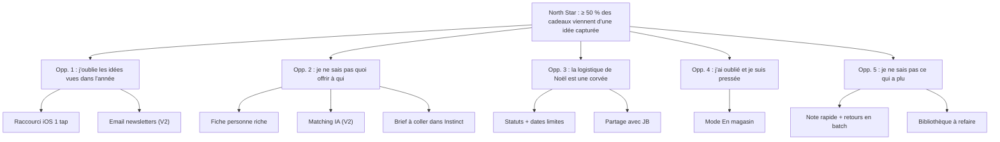
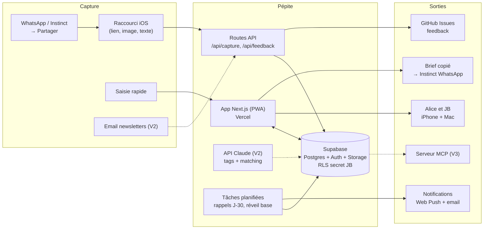
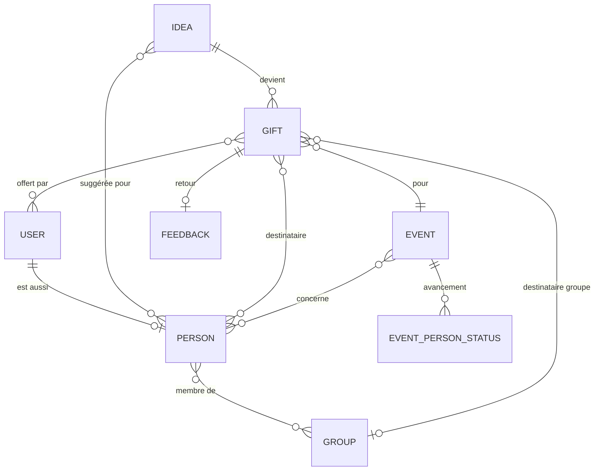

# Pépite — Spec produit & delivery

> Nom de travail : **Pépite** (à confirmer). Statut : **V1 en cadrage**. Mis à jour : 2026-10-30. Owner : Alice He-Guyot.
> Ce fichier est la **source de vérité** du projet. Toute décision s'ajoute au [Journal des décisions](#19-journal-des-décisions). Il sert aussi de contexte pour Claude dans VS Code (voir [§20](#20-instructions-pour-lagent-de-dev-claude)).

---

## 1. One-liner, problème, vision

**One-liner :** *Offrir sans corvée, recevoir sans déception.*

**Problème :**
1. Je vois plein d'idées de cadeaux dans l'année (scroll, rue, newsletters, discussions avec JB) et je les oublie au moment où j'en ai besoin.
2. Offrir devient une corvée, surtout à Noël, quand une famille nombreuse concentre tous les cadeaux au même moment.
3. Sans mémoire de ce qui a plu, je risque de décevoir.

**Concept :** un carnet de cadeaux intelligent. On jette une idée en 2 secondes depuis n'importe où. L'app la relie aux personnes à qui elle peut aller, la ressort à J-30 de l'événement, suit la commande jusqu'à la remise et garde la mémoire de ce qui a plu. JB partage le travail sans jamais voir ses propres cadeaux.

**Ce que ce n'est pas :** un moteur de recherche de produits ni un outil de paiement. Instinct (ou un autre agent) trouve et achète ; Pépite se souvient et planifie.

**Vision à 3 ans :** offrir un cadeau juste ne dépend plus de la mémoire ni du rush de décembre. C'est la conséquence naturelle de ce qu'on remarque toute l'année. À terme, Pépite devient la mémoire cadeaux que n'importe quel agent d'achat peut interroger, et ma bibliothèque de cadeaux réussis sert à conseiller les gens qui n'ont pas d'idée.

---

## 2. Utilisateurs et jobs-to-be-done

| Utilisateur | Rôle | Accès |
|---|---|---|
| Alice | Propriétaire, utilisatrice principale | Tout |
| JB | Co-organisateur : brainstorme, commande | Tout **sauf** les cadeaux et idées dont il est destinataire |
| Fils (2 ans) | Destinataire uniquement | Aucun |

**Jobs-to-be-done** (quand… je veux… pour…) :
1. **Capturer** — Quand je vois une idée, je veux la garder en 2 secondes, pour ne pas l'oublier.
2. **Retrouver** — Quand un événement approche, je veux voir les idées déjà gardées qui collent à la personne, pour ne pas repartir de zéro.
3. **Viser juste** — Quand je pense à quelqu'un, je veux voir ce que je lui ai offert, ce qui a plu et où il en est dans sa vie.
4. **Dépanner** — Quand j'ai oublié un anniversaire et que je passe devant une librairie ou un magasin de jeux, je veux savoir quoi acheter **ici, maintenant**.
5. **Livrer** — Quand j'ai choisi, je veux suivre la commande jusqu'à la remise, pour ne rien rater.
6. **Reproduire** — Quand un cadeau a marché, je veux pouvoir le refaire pour d'autres.
7. **Brainstormer** — Quand je n'ai pas d'idée, je veux un brief prêt à envoyer à Instinct.

---

## 3. Principes produit

1. **3 onglets, jamais plus :** ＋ Capturer · Personnes · Agenda. Une fonctionnalité qui n'entre dans aucun des trois va dans `BACKLOG.md`.
2. **Capturer sans réfléchir :** zéro champ obligatoire. On range plus tard, ou l'IA range.
3. **La fiche personne est le cœur :** historique, goûts, idées, cadeaux en cours.
4. **L'app pousse, je ne cherche pas :** rappel à J-30, puis à la date limite de commande.
5. **Une feature entre seulement si elle en remplace une autre, ou si elle a été demandée 3 fois.**
6. **Mes données m'appartiennent :** export complet à tout moment, code dans mon GitHub.
7. **Le secret est sacré :** aucune fuite vers un destinataire, nulle part (écran, notification, aperçu de lien, export partagé).

**Anti-objectifs :** pas de comparateur de prix, pas de paiement intégré, pas de réseau social, pas de liste de souhaits partagée (mes envies sont des idées sur ma propre fiche).

---

## 4. Périmètre et roadmap

**North Star :** % des cadeaux offerts qui viennent d'une idée capturée dans Pépite. Objectif Noël 2026 : ≥ 50 %.

| Version | Date cible | Question à valider | Contenu | Gate pour passer à la suite |
|---|---|---|---|---|
| **V0 — Maquette** | 2 nov. 2026 | La navigation à 3 onglets tient-elle ? | Maquette cliquable sur iPhone | Je m'y retrouve sans explication |
| **V1 — Noël** | **9 nov. 2026** | Est-ce que je capture vraiment, et est-ce que ça m'aide pour Noël ? | Personnes, groupes, idées, collections thématiques, cadeaux et statuts, statut « trouvé » par personne, événements et J-30, mode « En magasin » (filtres), accès JB masqué, raccourci iOS, « Copier le brief », « Ça cloche », export, import de mes notes actuelles | 20 idées capturées en 2 semaines ; tous les cadeaux de Noël suivis dans l'app |
| **V2 — Intelligence** | Janvier 2027 | L'IA fait-elle gagner du temps ? | Tagging IA des captures, matching idée ↔ personne, adresse email pour les newsletters, retours en batch, bibliothèque « à refaire », mode « En magasin » avec suggestions IA | > 70 % des tags acceptés sans correction |
| **V3 — Ouverture** | Printemps 2027 | Est-ce que ça marche pour d'autres ? | Serveur MCP, intégration Instinct si API, rappels de retrait géolocalisés, « Partager mes pépites » (conseiller des gens sans idée à partir de ce que j'ai offert), test avec 3 à 5 familles | 3 familles actives après 1 mois |

---

## 5. Story map

Les colonnes suivent le parcours. Chaque ligne est une version : on lit la V1 de gauche à droite comme un parcours complet, même minimal.

| | Capturer | Relier | Préparer | Choisir | Commander | Récupérer | Offrir | Noter |
|---|---|---|---|---|---|---|---|---|
| **V1** | Raccourci iOS (lien, image, texte) ; saisie rapide ; depuis WhatsApp/Instinct par Partager | Je tague moi-même la ou les personnes | Événements + J-30 ; fiche personne ; « Copier le brief » pour Instinct | Passer une idée en cadeau ; mode « En magasin » (filtres) | Statut « commandé », date limite | Statut « à récupérer » + lieu | Statut « offert » | Note rapide (a plu / bof / raté) |
| **V2** | Email newsletters ; IA lit les screenshots | L'IA propose les personnes | Suggestions IA par personne | Bibliothèque « à refaire » ; suggestions IA en magasin | — | — | — | Retours en batch après l'événement |
| **V3** | — | — | Agent (MCP) qui prépare un brief | — | Instinct commande depuis l'app | Rappel géolocalisé | — | — |

---

## 6. Kano

| Fonctionnalité | Catégorie Kano | Conséquence |
|---|---|---|
| Capture en 2 s, sans perte | Indispensable | V1, non négociable |
| Cadeaux de JB invisibles pour JB | Indispensable | V1, testé automatiquement |
| Rappels J-30 | Indispensable | V1 |
| Statuts de commande | Performance (plus c'est fluide, mieux c'est) | V1 simple |
| Historique « ce qui a plu » | Performance | V1 saisie, V2 batch |
| Mode « En magasin » | Performance | V1 filtres, V2 IA |
| Export complet des données | Indispensable (attendu, invisible) | V1 |
| IA qui range et propose les personnes | Attractif (« wow ») | V2 seulement |
| Collections thématiques (naissance, enfants…) | Performance | V1 |
| Statut « trouvé » par personne pour Noël | Indispensable (c'est ce que je fais déjà) | V1 |
| Partager mes pépites pour conseiller d'autres | Attractif | V3 |
| Calcul automatique des années de mariage, de l'âge des enfants | Attractif, mais coûte peu | V1 |
| Rappel géolocalisé de retrait | Attractif | V3 |

Règle : aucun « attractif » avant que tous les « indispensables » marchent.

---

## 7. Opportunity Solution Tree



---

## 8. Spécifications fonctionnelles V1

Format : user story → critères d'acceptation (CA). « Je » = Alice ou JB, sauf mention contraire.

### 8.1 Onglet ＋ Capturer

**US-C1 — Capture par le raccourci iOS**
En tant qu'Alice, je partage un lien, une image ou un texte depuis n'importe quelle app (Instagram, Safari, Photos, WhatsApp, y compris un message d'Instinct) vers « Idée cadeau ».
- CA1 : le raccourci apparaît dans la feuille de partage iOS.
- CA2 : entre le tap et la confirmation, il s'écoule moins de 2 s sur réseau 4G.
- CA3 : l'idée est créée avec la source, l'URL ou l'image et la date. Aucun autre champ n'est requis.
- CA4 : le raccourci propose en option d'ajouter une note texte ou vocale (dictée) et une ou plusieurs personnes. On peut passer.
- CA5 : sans réseau, l'idée n'est pas perdue. *Solution à valider techniquement :* le raccourci la garde dans une note Apple « Pépite — en attente », à importer ensuite.
- CA6 : le raccourci s'authentifie par un jeton personnel (un par utilisateur), révocable depuis l'app.

**US-C2 — Saisie rapide dans l'app**
- CA1 : un bouton ＋ visible depuis tous les onglets.
- CA2 : un seul champ texte (titre ou lien collé), plus photo et dictée en option.
- CA3 : un lien collé est enrichi automatiquement (titre, image, prix si disponible) via l'aperçu Open Graph.

**US-C3 — Boîte de réception des idées**
- CA1 : les idées sans personne associée apparaissent dans « À trier ».
- CA2 : trier = associer à 0..n personnes ou groupes, ou archiver. Faisable en lot.

### 8.2 Onglet Personnes

**US-P1 — Fiche personne**
Champs (tous facultatifs sauf le nom) : nom, surnom, date de naissance, **partielle acceptée** (mois seul, année inconnue, « à vérifier ») ; l'âge est toujours calculé, jamais écrit à la main dans la description, étape de vie (texte libre + tags : nouveau-né, bébé, enfant, ado, étudiant, jeune parent…), situation familiale, goûts, n'aime pas, préférences (ex. Made in France, éco, pas de plastique), fourchette de prix habituelle, adresse (pour les activités), tailles, notes.
- CA1 : la fiche montre en haut le **prochain événement** et le nombre d'idées en attente.
- CA2 : sections : Idées pour lui/elle · Cadeaux en cours · Historique (avec retours) · Infos.
- CA3 : les 18 personnes de départ sont importables en une fois (CSV ou texte dicté transformé par Claude hors app pour la V1).

**US-P2 — Groupes**
- CA1 : un groupe (couple, famille) regroupe des personnes et peut recevoir un cadeau.
- CA2 : la fiche d'un membre montre aussi les cadeaux reçus via ses groupes.

**US-P3 — Copier le brief pour Instinct**
- CA1 : un bouton sur la fiche copie un texte prêt à coller : prénom, âge, étape de vie, goûts, préférences, budget, ce qui a déjà été offert et noté, événement et date limite.
- CA2 : le brief ne contient ni adresse ni nom de famille, par défaut.

### 8.3 Onglet Agenda

**US-A1 — Événements**
Types : Noël, anniversaire, anniversaire de mariage (avec l'année de référence → « 10 ans de mariage »), Saint-Valentin, naissance, fête des mères/pères, invitation ponctuelle, autre.
- CA1 : un anniversaire est créé automatiquement à partir de la date de naissance d'une fiche, récurrent chaque année.
- CA2 : Noël est un événement unique qui regroupe toutes les personnes cochées.
- CA3 : la vue Agenda liste les événements des 90 prochains jours, avec pour chacun le nombre de cadeaux par statut.

**US-A2 — Cadeaux et statuts**
Statuts : `idée retenue → choisi → commandé → à récupérer → prêt (emballé) → offert`.
- CA1 : un cadeau vient d'une idée (ou est créé directement), a 1..n destinataires (personnes ou groupe), 1..n offreurs (moi, JB, autres en texte libre), un événement et un format (objet, activité, bon cadeau, expérience partagée où je m'inclus).
- CA2 : champs optionnels : prix réel, lien de commande, date limite de commande, lieu de retrait, numéro de suivi.
- CA3 : une même idée peut donner plusieurs cadeaux (pour plusieurs personnes).
- CA4 : vue « À faire » triée par urgence : à commander avant X, à récupérer.

**US-A3 — Rappels**
- CA1 : notification à J-30 de chaque événement : « Anniversaire de Léa dans 30 jours — 3 idées en stock ».
- CA2 : notification à la date limite de commande −3 jours.
- CA3 : aucune notification ne cite le contenu d'un cadeau (voir §9, secret).
- CA4 : notifications Web Push sur la PWA installée (iOS 16.4+), avec un email de secours.

### 8.4 Mode « En magasin » (dépannage)

Cas : *j'ai oublié l'anniversaire, je passe devant une librairie ou un magasin de jeux.*
- CA1 : accessible en 1 tap depuis l'Agenda (« Je suis en magasin »).
- CA2 : je choisis la personne (ou l'événement du jour), puis le type de magasin : librairie, jeux de société, jouets, déco, mode, épicerie fine, fleuriste, autre.
- CA3 : l'app affiche les idées en stock pour cette personne qui correspondent à ce type de magasin, puis ce qui a plu dans le passé à des profils similaires (même âge ou étape de vie).
- CA4 : affichage du budget habituel et des « n'aime pas ».
- CA5 (V2) : suggestions IA (« 3 livres pour une fille de 6 ans qui aime les animaux »).

### 8.5 Partage avec JB et secret

- CA1 : JB a un compte et voit tout, sauf les cadeaux et idées dont il est destinataire (directement ou via un groupe dont il fait partie).
- CA2 : un cadeau commun dont JB est co-destinataire (ex. un week-end pour nous trois) est **visible par JB par défaut** ; le créateur peut le masquer.
- CA2 bis : les idées que je crée pour moi-même (mes envies) sont visibles par moi et par JB. Elles remplacent la liste de souhaits.
- CA3 : JB peut créer, modifier, commander, changer les statuts.
- CA4 : la règle est appliquée **dans la base** (RLS), pas seulement à l'écran.
- CA5 : des tests automatiques vérifient qu'aucune requête faite en tant que JB ne renvoie un de ses cadeaux.

### 8.6 Ce que mes notes actuelles imposent

Source : mes deux notes Apple (« Cadeaux pour tous », « Liste de cadeaux pour Alice, JB et Emile »), analysées le 2026-10-30.

**US-N1 — Statut « trouvé » par personne pour un événement**
- CA1 : pour chaque personne d'un événement (ex. Noël), un statut `à trouver` / `trouvé` / `offert`.
- CA2 : l'Agenda affiche l'avancement : « Noël : 11/18 trouvés ».

**US-N2 — Collections thématiques**
- CA1 : une idée peut n'appartenir à personne et vivre dans une collection : Enfants, Naissance, Parents, Famille, Autres (liste modifiable).
- CA2 : une idée peut viser plusieurs personnes à la fois (ex. une sortie pour deux cousines, une même idée pour les deux parents de JB).
- CA3 : le mode « En magasin » et la fiche personne proposent aussi les idées des collections qui correspondent à l'âge ou l'étape de vie.

**US-N3 — Mes principes**
- CA1 : un texte libre « Mes principes » dans les réglages (ex. cadeau personnalisé avec une signification, pas de cliché ; couple : commun ou séparé ; moins d'activités à faire avec nous).
- CA2 : ces principes sont inclus dans le brief copié pour Instinct (et dans les prompts IA en V2).

**US-N4 — Logistique selon le lieu**
- CA1 : la fiche a une ville et un pays, et un mode de remise : en main propre, envoi postal, via quelqu'un.
- CA2 : pour un envoi à l'étranger, la date limite de commande est avancée (délai configurable par pays).

**US-N5 — Activités à organiser**
- CA1 : un cadeau au format activité peut avoir le statut `à planifier`, sans date.
- CA2 : option « bon cadeau » si le site le permet, sinon « carte » à imprimer.

**US-N6 — Sources d'inspiration**
- CA1 : une liste de liens (sites, listes partagées, newsletters) accessible depuis ＋ Capturer.

**US-N7 — Import initial**
- CA1 : mes deux notes sont converties (par Claude, hors app) en fichier d'import : personnes + description, cadeaux déjà offerts qui ont plu, idées, choix, statut « trouvé », collections.

### 8.7 Retours sur les cadeaux

- CA1 : sur un cadeau offert : a plu / bof / raté, commentaire, « à refaire pour d'autres » (oui/non), « demandé par la personne » (oui/non).
- CA1 bis : je peux aussi noter les cadeaux que JB ou moi avons **reçus** et de qui (ex. une lampe pour mon anniversaire), pour la mémoire de la famille.
- CA2 (V2) : écran « Retours en batch » après un événement : une carte par cadeau, 3 boutons, 30 s par cadeau.
- CA3 : les idées « à refaire » alimentent la bibliothèque, filtrable par âge, étape de vie, format, budget.

### 8.8 « Ça cloche » (feedback sur l'app)

- CA1 : un bouton discret disponible sur tous les écrans.
- CA2 : il enregistre le texte libre, l'écran, l'horodatage, l'utilisateur et une capture d'écran en option.
- CA3 : chaque retour crée une **issue GitHub** avec le label `feedback` (via l'API, jeton côté serveur).
- CA4 : le processus d'analyse est en §14.

### 8.9 Export

- CA1 : « Tout exporter » produit une archive ZIP : un CSV par table et les images.
- CA2 : l'export respecte le secret (JB n'exporte pas ses propres cadeaux).

### 8.10 Décisions issues du prototype V0 (31 oct. 2026)

Ces règles **remplacent** les passages contraires plus haut (notamment §8.4 et les noms d'onglets).

**Navigation.** 3 onglets : Agenda · ＋ · Carnet. Carnet contient 3 vues : Personnes, Idées, Offerts. Le mode « En magasin » est supprimé : la même situation passe par Carnet > Idées avec un filtre par rayon (Librairie, Jouets, Mode, Épicerie fine…).

**Groupes, 3 niveaux.**
1. Cercles : Famille de JB, Ma famille, Oncles tantes et cousins, Nous.
2. Foyers dans un cercle (Antoine, Azhar et les filles ; Mama et Papa…), typés Famille, Couple, Parent enfant, Seule, Cousins.
3. Groupes transverses entre familles (Les cousines, Fratrie de JB, JB et Emile). Une personne appartient à 1 cercle, 1 foyer et 0..n groupes transverses.
Un événement (ex. Noël 2026) se crée en cochant des cercles, foyers ou groupes ; sa vue est rangée par cercle avec l'avancement de chacun.

**Statuts d'une personne pour un événement.** À trouver (rond vide) → Piste (rond à moitié plein : un thème sans produit, ex. « jeu de société ») → Trouvé (rond plein). Une piste porte le bouton « Chercher avec Instinct ».

**Statuts d'un cadeau.** Choisi → Commandé → Prêt → Offert. « À récupérer » est une case sur Commandé (retrait en magasin), pas une étape. On avance d'un tap sur la carte du cadeau.

**Notation.** 3 niveaux : Effet wow, A marché, Pas marché (+ commentaire). Trois filets pour ne pas oublier :
1. une feuille de notation s'ouvre au passage en Offert (« Plus tard » possible) ;
2. notification J+3 après l'événement → écran « À noter » en lot, un tap par cadeau ;
3. JB peut noter aussi. Un cadeau non noté reste « À noter » sur la fiche et dans Offerts.

**À faire : généré, jamais saisi.** Règles, triées par date limite :

| Situation | Tâche | Date limite |
|---|---|---|
| Personne sans cadeau, événement à ≤ 30 j | Trouver pour X | date de l'événement |
| Piste, événement à ≤ 30 j | Préciser la piste | date de l'événement |
| Objet choisi, pas commandé | Commander X | événement − délai d'envoi du pays |
| Activité choisie | Réserver X | date de l'événement |
| Commandé avec retrait | Récupérer X | date de l'événement |
| Offert non noté | Noter N cadeaux | maintenant |

Délais d'envoi par défaut, réglables : France 3 j, Royaume-Uni 10 j, États-Unis 15 j.

**Portrait : 5 rubriques identiques pour tous.** Situation, Passions, Style, À éviter, Envies. L'âge, la ville, « A marché » et « Pas marché » sont calculés. La fiche affiche un score de complétude (ex. 2/5) et « à compléter » sur les rubriques vides ; la liste Personnes montre ce score pour repérer les portraits faibles.

**Brief : sur la personne, pas sur l'événement.** Généré depuis le portrait, même format pour tous :
```
Idée cadeau pour <prénom>, <âge>, <ville>.
<Rubrique> : <valeur>.            (une ligne par rubrique remplie)
A marché : <cadeaux>.
Pas marché : <cadeaux (commentaire)>.
Déjà en tête : <idées>.
Mes principes : <mes principes>.
Propose 5 idées précises avec lien, prix et pourquoi ça lui irait.
```
Jamais d'adresse ni de nom de famille. L'écran du brief rappelle les rubriques manquantes. Variante piste : dernière ligne « 5 produits sur le thème <piste> ».

**Ma fiche « Moi ».** Dans le cercle Nous. Mes envies y sont des idées comme les autres, visibles par JB. « Moi » apparaît dans « Pour qui » à la capture.

**Idée.** Une idée contient : titre, personnes ou groupe, commentaire, liens (où acheter, page Instinct), rayon, collection, et le marqueur Piste.

**Mise à jour du 31 oct. (2e retour prototype)**
- **Catégories d'idées** (remplacent collections et rayons) : Naissance, Enfants / jouets, Activités, Grossesse / parents, Librairie, Secret Santa, Anniversaire ami. Filtres en plus : Pistes, Sans personne.
- **Agenda = événements, pas de liste « À faire ».** Les règles d'À faire ci-dessus servent à écrire la prochaine action sous chaque événement (« Céramicafé à réserver », « rien de choisi »). La notation en lot se lance depuis Carnet > Offerts (« Noter N cadeaux »).
- **Pas de score de complétude** du portrait. Les rubriques vides affichent « à compléter » en gris ; Alice remplit elle-même.
- **DA plus joyeuse** : accent framboise #C2255C (alternatives testables : cobalt #2F5BEA, violet #7B4FD6, vert #1E7A5A), jaune soleil #FFF1B8 pour ce qui se prépare, pastels pour les personnes, titres en Bricolage Grotesque, texte en Instrument Sans. Toujours pas d'orange.

---

## 9. Exigences non fonctionnelles (performances critiques)

| # | Exigence | Seuil | Comment on le vérifie |
|---|---|---|---|
| NF1 | Temps de capture (tap → confirmation) | < 2 s en 4G | Chrono manuel sur 10 captures |
| NF2 | Ouverture de l'app installée | < 1 s jusqu'à l'onglet affiché | Lighthouse + test iPhone |
| NF3 | Aucune perte de capture | 0 idée perdue | Compteur côté raccourci vs base |
| NF4 | **Secret** | 0 fuite (écran, notification, aperçu, export, email) | Tests RLS automatiques en CI |
| NF5 | Rappels | 100 % des J-30 envoyés | Log des envois + vérification hebdo |
| NF6 | Disponibilité | Pas de pause de la base | Tâche quotidienne qui la réveille, ou plan payant |
| NF7 | Portabilité | Export complet en 1 clic | Test d'export à chaque version |
| NF8 | Mobile d'abord | Utilisable d'une main sur iPhone | Revue de la maquette V0 |

---

## 10. Architecture



**Stack :**

| Couche | Choix | Pourquoi |
|---|---|---|
| Front | Next.js (App Router, TypeScript), Tailwind, PWA installée | Une seule base de code pour iPhone et Mac ; tu codes dans VS Code |
| Hébergement | Vercel, plan Hobby | Gratuit pour un usage perso ; déploiement à chaque push |
| Base, auth, fichiers | Supabase (Postgres, Auth par lien magique, Storage) | RLS pour le secret ; export Postgres standard |
| Notifications | Web Push (PWA iOS 16.4+) + email de secours | Pas d'app native nécessaire |
| Tâches planifiées | Vercel Cron | Rappels quotidiens, réveil de la base |
| IA (V2) | API Claude | Lecture des images, tags, matching |
| Feedback | API GitHub Issues | Les retours vivent à côté du code |
| Raccourci | Apple Shortcuts → `POST /api/capture` avec jeton | Remplace une app native |

**Pourquoi pas une app native maintenant :** compte Apple Developer payant (99 €/an), cycle de publication plus lent. À reconsidérer en V3.

---

## 11. Modèle de données



**Tables (champs principaux) :**

| Table | Champs |
|---|---|
| `users` | id, email, display_name, person_id (lien vers sa fiche), capture_token_hash |
| `persons` | id, name, nickname, description (portrait libre), birth_year, birth_month, birth_day (chacun optionnel : dates partielles acceptées), birth_date_uncertain (bool), life_stage_tags[], family_situation, likes, dislikes, preferences[], budget_min, budget_max, city, country, delivery_mode (`in_person`, `post`, `via_someone`), address, sizes, notes, created_by |
| `groups` | id, name, type (`couple`, `family`, `other`) |
| `group_members` | group_id, person_id |
| `ideas` | id, title, url, image_path, source (`shortcut`, `whatsapp`, `email`, `manual`, `store`), price, store_type, format (`object`, `activity`, `voucher`, `shared_experience`), collections[], tags[], note, status (`inbox`, `sorted`, `archived`), is_reusable, created_by, created_at |
| `idea_persons` | idea_id, person_id |
| `events` | id, type, title, date, recurrence (`yearly`, `none`), reference_year, created_by |
| `event_persons` | event_id, person_id |
| `gifts` | id, idea_id, event_id, title, format, status (dont `to_plan` pour une activité sans date), requested_by_recipient (bool), received (bool : cadeau reçu par Alice ou JB), price_paid, order_url, order_deadline, pickup_place, tracking, visible_to_recipient_users (bool, défaut false), created_by |
| `gift_recipients` | gift_id, person_id \| group_id |
| `gift_givers` | gift_id, user_id \| free_text |
| `gift_feedback` | gift_id, rating (`loved`, `ok`, `miss`), comment (ex. « bien mais trop glissants »), redo (bool) |
| `event_person_status` | event_id, person_id, status (`to_find`, `found`, `given`) |
| `settings` | user_id, gift_principles (texte), inspiration_links[], shipping_delays_by_country |
| `app_feedback` | id, user_id, screen, text, screenshot_path, github_issue_url, created_at |

**Règle de secret (RLS), en clair :**
> Un utilisateur U ne peut lire un cadeau G que si U n'est pas destinataire de G, ni directement (via `users.person_id`), ni via un groupe dont sa fiche est membre — sauf si `visible_to_recipient_users = true`. La même règle s'applique aux idées liées à sa fiche — sauf celles qu'il a créées lui-même (ses envies) — et aux notifications et exports générés pour lui. Un cadeau commun dont il est co-destinataire est créé avec `visible_to_recipient_users = true` par défaut.

---

## 12. Intégration Instinct

**Constat (30 oct. 2026) :** Instinct n'a pas d'API publique connue. Le mien n'est connecté qu'à WhatsApp.

| Sens | V1 (sans intégration) | Plus tard |
|---|---|---|
| Instinct → Pépite | Appui long sur son message WhatsApp → Partager → « Idée cadeau » | API ou MCP si Instinct en ouvre un |
| Pépite → Instinct | « Copier le brief » depuis la fiche, collé dans WhatsApp | Instinct lit Pépite (Google Sheet miroir si je le connecte à Google, ou MCP) |

Instinct n'a **pas besoin d'écrire** dans Pépite en V1 : le raccourci de partage couvre ce besoin.

---

## 13. Sécurité et données personnelles

- Hébergement Supabase en région UE.
- Données sensibles : adresses, dates de naissance d'enfants. Le brief pour Instinct exclut l'adresse et le nom de famille par défaut.
- Instinct entraîne ses modèles par défaut : désactiver ce réglage dans ses paramètres.
- Le jeton du raccourci est stocké haché et révocable.

---

## 14. Boucle de feedback

1. **Capter :** « Ça cloche » dans l'app → une issue GitHub `feedback` (ou je le dis directement à Claude).
2. **Analyser (chaque semaine, Claude) :** pour chaque issue :
   - **Constat :** ce qui s'est passé.
   - **5 pourquoi :** jusqu'à la cause racine.
   - **Origine :** code · spec · usage · décision produit.
   - **Qui change quoi :** Claude (code, spec), Alice (habitude, décision), ou les deux.
   - **Garde-fou :** test, règle de spec ou principe ajouté pour que ça ne revienne pas.
3. **Consigner :** la décision va dans le [Journal des décisions](#19-journal-des-décisions), le garde-fou dans la spec ou les tests.
4. **Rétro après Noël :** North Star, gates, top 3 irritants, ce qu'on arrête.

---

## 15. Risques

| Risque | Type | Probabilité | Parade |
|---|---|---|---|
| Capture plus lente qu'un screenshot → retour à la pellicule | Usage | Haute | Raccourci en 1 tap, zéro champ obligatoire, NF1 |
| V1 pas prête pour Noël | Delivery | Haute | Périmètre V1 figé ; l'IA attend janvier ; je capture dès maintenant (screenshots envoyés à Claude) |
| Usine à gaz | Produit | Moyenne | 3 onglets, `BACKLOG.md`, règle « une entre, une sort » |
| JB voit un de ses cadeaux | Sécurité | Moyenne | RLS + tests CI + notifications neutres |
| Saisie initiale trop longue | Usage | Moyenne | Import CSV préparé avec Claude |
| Pas de retours notés | Usage | Moyenne | Écran batch en janvier |
| Base gratuite mise en pause après 7 jours d'inactivité | Technique | Moyenne | Vercel Cron quotidien |
| Raccourci iOS sans réseau | Technique | Moyenne | Note Apple en secours, à valider en V0 |
| Instinct change ou disparaît (bêta) | Dépendance | Moyenne | Aucune dépendance dure ; brief copiable vers tout agent |
| Données famille exposées | Données | Faible | §13 |
| Maintenance qui grignote les soirées | Personnel | Moyenne | Stack managée ; plafond 1 soirée/mois hors nouveautés |
| Ne marche que pour moi | Marché | Inconnue | Rien de générique avant V3 |

---

## 16. Coûts

| Poste | Coût mensuel |
|---|---|
| Vercel Hobby | 0 € |
| Supabase Free | 0 € (Pro : 25 $/mois si besoin) |
| API Claude (V2) | Quelques euros (estimation, à mesurer) |
| Nom de domaine | ~1 €/mois (optionnel) |
| Apple Developer | 0 € (99 €/an seulement si app native en V3) |

---

## 17. Release statement V1

> **Pépite V1 : vos idées cadeaux ne se perdent plus.**
>
> *Paris, novembre 2026.* Pépite sort aujourd'hui sur iPhone et Mac, pour Alice et JB. C'est le carnet de cadeaux de la famille : on y garde une idée en un geste, depuis n'importe quelle app, et elle ressort au bon moment.
>
> **Le problème.** On croise des dizaines de bonnes idées dans l'année, mais elles dorment dans la pellicule, des newsletters ou un fil WhatsApp. À l'approche de Noël, on repart de zéro, dans l'urgence, et on risque de décevoir.
>
> **La solution.** Depuis le menu Partager de l'iPhone, une idée est capturée en 2 secondes. Chaque proche a sa fiche : ce qu'il aime, où il en est dans sa vie, ce qu'on lui a déjà offert et ce qui a plu. Un mois avant chaque événement, Pépite rappelle qui fêter et propose les idées en stock. Pris de court devant une librairie ? Le mode « En magasin » dit quoi prendre. JB peut tout voir et tout faire, sauf découvrir ses propres cadeaux.
>
> « Avant, je retrouvais le screenshot parfait… le 26 décembre. » — Alice (citation à valider après Noël)

---

## 18. Questions ouvertes

- [ ] Nom définitif (Pépite ?) et disponibilité du domaine.
- [ ] « Partager mes pépites » (V3) : anonymiser les destinataires (« ma nièce, 5 ans ») plutôt que les prénoms ?
- [ ] Faisabilité du raccourci hors-ligne (à tester en V0).
- [ ] Je connecte Instinct à Google un jour, ou pas ?

---

## 19. Journal des décisions

| Date | Décision | Pourquoi |
|---|---|---|
| 2026-10-30 | Usage perso d'abord ; ouverture éventuelle en V3 | Valider que le modèle marche avant de généraliser |
| 2026-10-30 | Vraie app codée (Next.js + Supabase, PWA), pas de no-code | Envie de prototyper dans VS Code et GitHub |
| 2026-10-30 | 3 onglets maximum | Éviter l'usine à gaz |
| 2026-10-30 | V1 utilisable pour Noël 2026 (cible 9 nov.) | Je dois l'utiliser dès ce Noël |
| 2026-10-30 | Pas d'intégration Instinct en V1 : partage WhatsApp + brief copié | Instinct n'a pas d'API publique connue et n'est connecté qu'à WhatsApp |
| 2026-10-30 | Secret JB appliqué en base (RLS) | Un bug d'écran ne doit jamais rien révéler |
| 2026-10-30 | Pas de liste de souhaits : mes envies sont des idées sur ma fiche, visibles par JB | Simplicité ; besoin réel = que JB les voie |
| 2026-10-30 | Cadeau commun (nous trois) visible par JB par défaut | Choix d'Alice |
| 2026-10-30 | Statut « trouvé » par personne, collections thématiques, mes principes, logistique selon le pays | Repris de mes notes actuelles |
| 2026-10-30 | Noter si un cadeau a été demandé par la personne, et les cadeaux reçus | Retours d'Alice sur l'import |
| 2026-10-31 | Onglets Agenda, ＋, Carnet (Personnes, Idées, Offerts) ; « En magasin » remplacé par un filtre rayon | Retour prototype : mode En magasin incompris |
| 2026-10-31 | Groupes à 3 niveaux : cercles, foyers, groupes transverses | Familles d'Alice et de JB, cousins, cadeaux communs |
| 2026-10-31 | Statut Piste ; cadeau Choisi → Commandé → Prêt → Offert | Thème sans produit précis |
| 2026-10-31 | Notation Effet wow / A marché / Pas marché, avec 3 filets anti-oubli | Choix d'Alice |
| 2026-10-31 | À faire généré automatiquement | Rien à saisir |
| 2026-10-31 | Portrait à 5 rubriques + brief centré sur la personne | Donner les bonnes infos pour tout le monde |
| 2026-10-31 | Catégories d'idées définies par Alice ; Agenda sans À faire ; pas de score de portrait ; DA framboise et soleil | 2e retour prototype |
| 2026-10-30 | Vision V3 : conseiller les gens sans idée à partir de mes cadeaux réussis | Idée d'Alice |
| 2026-10-30 | Ajout du mode « En magasin » | Cas réel : anniversaire oublié, passage en librairie ou magasin de jeux |
| 2026-10-30 | Feedback app → issues GitHub + analyse hebdo par Claude | Boucle d'amélioration continue |
| 2026-10-30 | Méthodes retenues : Opportunity Solution Tree, Kano, story map | Trier le backlog quand les idées arrivent |
| 2026-11-07 | Lien magique accepté au format `token_hash` (vérifié côté serveur) en plus du `code` PKCE | Le lien ouvert sur un autre appareil ou navigateur que celui de la demande échouait (Mail iPhone vs Mac) |
| 2026-11-07 | Accès aux données réservé aux comptes listés dans `users` (Alice, JB) ; un compte Auth inconnu ne voit rien | L'inscription par lien magique reste ouverte côté Supabase |
| 2026-11-07 | Secret étendu aux groupes : un cadeau ou une idée pour un groupe de JB, ou pour le cercle de son foyer, lui est masqué ; exception pour ce qu'il a créé lui-même | §8.10 (cercles, foyers, groupes transverses) et cadeaux reçus notés par JB |
| 2026-11-07 | `users.person_id` non modifiable depuis l'app | Changer sa fiche liée contournerait le secret |
| 2026-11-07 | Schéma V1 aligné sur §8.10 : `event_persons.status` (to_find, lead, found, given), cadeau chosen, to_plan, ordered, ready, given avec case `needs_pickup`, notation wow, worked, miss, catégorie d'idée en texte libre, portrait à 5 rubriques | Les décisions du prototype priment sur §11 |
| 2026-11-07 | Import initial : groupes importés en transverses (à ranger en cercles et foyers), loved → Effet wow, ok → A marché, collection → catégorie, tout créé au nom d'Alice | Choix d'Alice ; JB ne voit donc aucun cadeau importé dont il est destinataire |
| 2026-11-07 | Connexion par mot de passe seul, sans email ni envoi d'email : un compte interne par personne (`<prénom>@pepite.local`), un mot de passe différent par personne | Le lien et le code par email exigent un SMTP personnalisé ; l'app installée sur iPhone ne partage pas sa session avec Safari |
| 2026-11-07 | Pour l'instant, un mot de passe commun pour tous (compte d'Alice) : tout le monde voit tout, le secret de JB est suspendu à l'écran | Choix d'Alice pour ouvrir l'app vite ; la RLS reste en place et se réactive avec un compte JB |
| 2026-11-14 | Carnet > Idées et capture ＋ : un lien collé prend le titre de son aperçu Open Graph (repli : nom du site) ; une idée sans destinataire va dans « Sans personne » ; supprimer = archiver | Rendre l'app utilisable avant Noël ; rien n'est effacé par erreur |
| 2026-11-14 | Une idée se supprime vraiment (croix sur la ligne, second tap pour confirmer), elle ne s'archive plus | Retour d'Alice (#9) |
| 2026-11-14 | On garde les 5 rubriques du portrait pour ce qui est structuré (situation, passions, style, à éviter, envies) ; les Notes libres deviennent modifiables et vont sous le portrait | Retour d'Alice (#26), pas sûre de l'utilité des catégories : les rubriques nourrissent le brief, les notes gardent le reste |
| 2026-11-14 | Parcours d'un cadeau dans un événement : À trouver → Choisi → Acheté → Prêt → Offert. L'avancement d'une personne et le statut d'un événement se déduisent des cadeaux rattachés ; on « retient » une idée pour l'événement. La case Piste disparaît : tout s'appelle Idées | Retours d'Alice #40 et #41 : le rond à faire tourner et la case Piste n'étaient pas clairs |
| 2026-11-15 | Plus de rubriques de portrait : tout tient dans les Notes (une info par ligne), seule la ville reste à part ; les rubriques existantes ont été versées dans les Notes | Retour d'Alice #64 : elle met à jour les notes, pas rubrique par rubrique. Remplace la décision du 31 oct. sur le portrait à 5 rubriques |

---

## 20. Instructions pour l'agent de dev (Claude)

À copier dans `CLAUDE.md` à la racine du repo.

- Lire `docs/SPEC.md` (ce fichier) avant toute tâche. Elle prime sur toute autre source.
- **Périmètre :** ne coder que la version en cours (§4). Toute nouvelle idée va dans `BACKLOG.md`, pas dans le code.
- **3 onglets :** refuser tout nouvel onglet ou menu de premier niveau ; proposer un emplacement dans un onglet existant.
- **Secret :** toute requête qui lit `gifts`, `ideas`, des notifications ou un export passe par des politiques RLS testées. Ajouter un test pour chaque nouvelle requête.
- **Mobile d'abord :** concevoir pour iPhone, une main, cibles tactiles ≥ 44 px.
- **Petits incréments :** une PR = une user story (§8), avec ses critères d'acceptation cochés dans la description.
- **Feedback :** pour chaque issue `feedback`, produire l'analyse §14 en commentaire de l'issue avant de corriger.
- **Décisions :** toute décision produit ou technique est ajoutée au §19.
- **Langue :** interface en français ; code et noms de tables en anglais.
